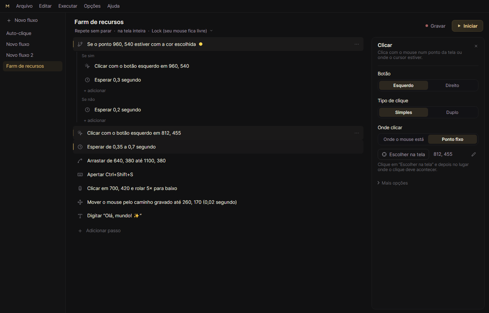
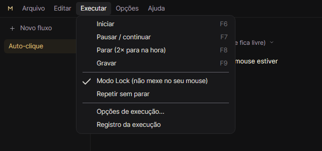

# Macro Midas

Automação de mouse e teclado para Windows, feita em **Avalonia UI** (.NET 9), com visual cinza‑escuro e detalhes em dourado.



Menu clássico e compacto no alto da janela: **Arquivo · Editar · Executar · Opções · Ajuda**.



## O que ele faz

- **Fluxos de passos**: clique (simples/duplo/N), mover (instantâneo ou suave), **arrastar**, **segurar/soltar botão**, **rolar** (4 direções), tecla/atalho (apertar, segurar, soltar, N vezes), digitar texto (acentos e emojis), esperar (fixo ou aleatório).
- **Condicionais ("Caso Se")**: o motor para e pergunta antes de seguir: *a cor do pixel é dourada? Se sim, faz o ENTÃO; se não, faz o SENÃO*. Também: cor dentro de uma área, janela existe, janela em foco, com opção de inverter (NÃO).
- **Esperar até**, **Repetir** (N vezes ou infinito) e **Parar / Próximo ciclo / Sair do Repetir**. Blocos podem ser aninhados.
- **Repetição do fluxo**: N vezes ou contínuo, intervalo entre ciclos, atraso inicial e velocidade (0,25× a 4×).
- **Gravação exata**: aperte F9, use o PC normalmente e aperte F9 de novo. O **caminho do mouse é gravado inteiro**, cada movimento e no mesmo ritmo; cliques, duplos cliques, arrastos (com o trajeto), cliques longos, rolagem, teclas com modificadores e os tempos entre eles viram passos editáveis.
- **Editor simples e explicado**: visual quase todo em cinza (dourado só fraquinho no essencial), passos escritos como frases, poucas escolhas por passo com explicação e o resto em "Mais opções", escolher posição/cor na tela com lupa (setas ajustam 1 px), **testar condição agora**, arrastar e soltar (inclusive para dentro/fora dos blocos), desfazer/refazer, copiar/colar (também como texto).
- **Vários fluxos**, salvos sozinhos. Sem modelos: na primeira vez só aparece um **Auto-clique** pronto para usar.
- **Importar/Exportar** em `.mmf` (Macro Midas Fluxe, formato próprio) ou `.txt` (roteiro legível).
- **Borda dourada pulsando na tela inteira** (todos os monitores) enquanto roda. O mouse atravessa a borda e ela **não aparece na leitura de pixels** das condições.
- **Barra translúcida** embaixo da tela com **Pausar** e **Parar**: **1× termina o ciclo atual e para, 2× mata na hora**. Fica opaca ao passar o mouse e dá para arrastar.
- **Modo Lock (padrão)**: o fluxo clica e digita **sem mexer no seu mouse e teclado**, na tela inteira ou numa janela escolhida, e você continua usando o PC (detalhes abaixo).
- **Atalhos globais configuráveis** (padrão F6 iniciar · F7 pausar · F8 parar · F9 gravar): clique na tecla para trocar, **“+ Adicionar”** para ter mais de uma tecla por ação e × para tirar. Cada fluxo também pode ter a sua tecla.
- **Configurações avançadas** com predefinições prontas (Equilibrado, Discreto, Destaque máximo, Desempenho).
- **Travas de segurança**: os cliques do fluxo nunca caem nas janelas do próprio Macro Midas; no modo Direto, mexer o mouse pausa o fluxo e jogá-lo no canto superior esquerdo para na hora.

## Como rodar

Requisitos: Windows 10/11 x64 e o [.NET 9 SDK](https://dotnet.microsoft.com/download/dotnet/9.0) para compilar.

```bash
dotnet run --project src/MacroMidas
```

Para gerar um executável único em `publish\MacroMidas.exe`:

```bash
powershell -ExecutionPolicy Bypass -File .\publish.ps1
```

Use `-SelfContained` no script para um exe que roda sem o .NET instalado (arquivo maior).

## Guia rápido

1. **Novo fluxo** (Ctrl+N, no alto da lateral ou em Arquivo). **Arquivo → Abrir…** (Ctrl+O) importa .mmf/.txt.
2. **Adicionar passo** (no fim da lista) mostra os tipos de passo com uma explicação de cada um; ou use **Gravar** (F9). Cada passo aparece como uma frase simples, por exemplo "Clicar com o botão esquerdo em 960, 540".
3. Clique num passo: à direita aparecem só as escolhas principais, cada uma com uma frase explicando. O resto fica em **Mais opções**. **Escolher na tela** abre a mira com lupa.
4. A frase embaixo do nome (ex.: "Repete sem parar · na tela inteira · Lock") abre as opções de execução (também em **Executar → Opções de execução…**): quantas vezes, modo Lock, onde (tela inteira ou uma janela), a tecla própria do fluxo e, em Mais opções, pausa entre voltas e velocidade.
5. **Iniciar** (F6). As bordas da tela pulsam de leve e a barra de controle aparece embaixo. **Parar** (F8 ou barra): 1 vez termina a volta atual; 2 vezes para na hora. **Pausar** (F7) solta botões/teclas seguros e os devolve ao continuar.
6. O menu do alto tem tudo à mão: **Arquivo** (novo, abrir, exportar, duplicar, apagar), **Editar** (desfazer, copiar/colar/duplicar/excluir passo), **Executar** (iniciar, pausar, parar, gravar, Modo Lock, Repetir sem parar), **Opções** (Configurações, borda, barra, sempre no topo) e **Ajuda**. O **⋯** de cada passo duplica, desativa, move e exclui; também dá para arrastar e soltar.

O **Registro da execução** (menu Executar) mostra cada condição avaliada, por exemplo:
`Se pixel (960, 540) = #FFD54A vs #FFD54A ±24 → SIM`.

## Modo Direto × modo Lock

| | Direto | Lock |
|---|---|---|
| Como funciona | `SendInput`: o mesmo mouse e teclado do sistema | Mensagens enviadas direto para a janela sob o ponto (tela inteira) ou para a janela escolhida |
| Seu mouse/teclado | Ficam ocupados enquanto roda | **Livres**: use o PC normalmente |
| Compatibilidade | Praticamente tudo | Apps Win32 clássicos, editores, muitos programas; alguns apps (jogos com entrada bruta, partes de Chromium/UWP) ignoram |
| Leitura de pixels | Da tela | Da tela (tela inteira) ou do conteúdo da janela escolhida, mesmo coberta por outras |
| Coordenadas | Tela (ou relativas à janela, se o alvo for janela) | Tela (tela inteira) ou relativas à área da janela |

O Lock é o padrão. **Jogos costumam ignorar o Lock** (leem o mouse e o teclado direto do hardware). Para eles, desligue o Lock (Executar → Modo Lock): o fluxo passa a usar o mouse de verdade e, enquanto roda, **mexer no mouse ou apertar uma tecla pausa na hora**, e você sempre retoma o controle. As teclas de Iniciar/Pausar/Parar funcionam mesmo dentro de jogos que bloqueiam atalhos do Windows.

Na tela inteira, cada clique vai para a janela que estiver embaixo do ponto, como se o Macro Midas não estivesse ali (as janelas dele nunca recebem os cliques). "Onde o mouse estiver" vale o ponto em que o mouse estava ao apertar F6 (ou, se você clicou em Iniciar, o ponto onde ele está ao fim da espera inicial, 1,5 s no Auto-clique, para dar tempo de apontar), e depois você mexe à vontade.

No Lock numa janela escolhida, uma moldura discreta fica sobre a janela travada, acompanha ela e, por padrão, bloqueia o seu mouse ali para um clique sem querer não atrapalhar. Janelas que você abrir passam por cima normalmente.

**Sobre "driver de mouse/teclado virtual":** no Windows, todo mouse, físico ou virtual (driver HID), move **o mesmo cursor**, e todo teclado digita na mesma janela em foco. Não existe um segundo cursor independente, então um driver virtual não deixaria você usar o PC ao mesmo tempo. Por isso o Lock usa mensagens direto para a janela: é o jeito que de fato separa o "mouse do fluxo" do seu. Para rodar um **jogo** em segundo plano enquanto usa o PC, o caminho é rodar o jogo (e o Macro Midas) dentro de uma máquina virtual ou em outro PC. No Linux/X11 daria para ter um segundo cursor real (uinput + MPX); isso fica como evolução futura, a arquitetura (`IInputBackend`) já permite.

**Rolar:** ao adicionar um passo "Rolar", o app já pede para você mostrar **onde** rolar e, por padrão, **clica no ponto antes de rolar** (como você faria), para a janela certa receber a rolagem.

## Condicionais e blocos

- **Se…**: cor do pixel, cor dentro de uma área, janela existe ou janela em foco, com tolerância por canal e opção **Inverter (NÃO)**. Passos do ENTÃO rodam se SIM; do SENÃO, se NÃO.
- **Esperar até**: verifica a condição a cada N ms; ao esgotar o tempo, continua, para o fluxo ou pula para o próximo ciclo.
- **Repetir**: N vezes ou infinito. A parada suave também encerra laços infinitos.
- **Parar / Pular**: parar o fluxo, ir para o próximo ciclo ou sair do Repetir atual.
- Botão **Testar agora** no painel da condição: avalia na hora e mostra o resultado.

## Atalhos

Globais (funcionam com qualquer janela em foco; troque em Opções → Configurações; a lista fica em Ajuda → Atalhos do teclado):

| Ação | Padrão |
|---|---|
| Iniciar / retomar | F6 |
| Pausar / retomar | F7 |
| Parar (1× termina o ciclo · 2× mata) | F8 |
| Gravar / concluir gravação | F9 |

Enquanto o app está aberto, essas teclas ficam reservadas para ele em todo o Windows.

No editor: `Del` excluir · `Ctrl+D` duplicar · `Ctrl+↑/↓` mover (entra e sai de blocos) · `Ctrl+C/V` copiar/colar · `Ctrl+Z/Y` desfazer/refazer · `Espaço` ativar/desativar · `↑/↓` navegar · `Esc` tirar seleção · `Ctrl+N` novo fluxo · `Ctrl+O` abrir.

## Formatos de arquivo

### `.mmf`: Macro Midas Fluxe

JSON com cabeçalho (`"format": "macro-midas-flow"`, `"version": 1`) e o fluxo completo. É o formato salvo em `%AppData%\MacroMidas\Flows`.

### `.txt`: roteiro legível

Um passo por linha; blocos `if/else/repeat` terminam com `end`. `#` no início da linha é comentário, `off:` desativa um passo e `// texto` no fim vira anotação.

```text
@name "Clique por cor"
@repeat forever            # ou: @repeat 10
@interval 100
@speed 1
@startdelay 300
@target window title="Bloco de Notas" process="notepad.exe"   # ou: @target screen
@input background          # background = Lock, direct = Direto
@hotkey "Ctrl+F1"

move 640 360 duration=200
moveby 10 -5
click left 100 200 count=2 hold=30 interval=60
click right                       // posição atual
down left 50 60
up left
drag left 100 100 -> 400 300 duration=500 hold=80
scroll down 3 at 500 500 interval=40 click=1   // click=1: clica no ponto antes de rolar
path 0,100,200 8,104,203 8,110,207                // caminho gravado: espera(ms),x,y de cada ponto
key ctrl+shift+s times=1 hold=30
keydown shift
keyup shift
type "Olá mundo\n" delay=15
wait 500
wait 300-800                      // aleatório
if pixel 100 200 #FFD54A tol=16
  click left 100 200
else
  next                            // próximo ciclo
end
waituntil not region 0 0 200 100 #FF0000 tol=20 timeout=5000 ontimeout=stop
repeat 5
  key down
  if window "Concluído"
    break                         // sai do repeat
  end
end
stop
```

Condições: `pixel X Y #cor`, `region X Y L A #cor`, `window "título"`, `active "título"`, com `not` na frente para inverter e `tol=N` para a tolerância.

## Limitações e cuidados

- **Apps como administrador**: sem admin, o Windows bloqueia cliques simulados neles. Use Opções → Configurações → Mais opções → Abrir como administrador (o app avisa quando detecta isso).
- **Jogos**: muitos usam entrada bruta (o Lock não alcança) e alguns têm anti-cheat que proíbe automação. Respeite os termos de cada jogo.
- **Lock**: atalhos com Ctrl/Alt podem não funcionar em segundo plano em alguns apps, pois eles conferem o estado real do teclado.
- **Janela minimizada** não renderiza pixels; no Lock o app restaura a janela sem ativá-la.

## Projeto

```
src/MacroMidas/
  Engine/         motor (thread própria, tempo preciso, pausa/parada suave/kill, condições)
  Input/          SendInput (Direto) e mensagens para janela (Lock), nomes de teclas
  Capture/        leitura de pixels (tela e PrintWindow)
  Hooks/          atalhos globais, hooks de baixo nível, gravador
  Serialization/  .mmf (JSON) e .txt (roteiro)
  Services/       biblioteca de fluxos, configurações, sobreposições, seletor de tela
  ViewModels/     MVVM (CommunityToolkit.Mvvm)
  Views/          janelas, editor, configurações, sobreposições (borda, Lock, barra, seletor)
  Styles/         cores, ícones e temas dos controles
tests/MacroMidas.Tests/  testes do motor, gravador, formatos e da interface (headless)
```

## Testes

```bash
dotnet test
```

Os testes de interface salvam capturas em `tests/MacroMidas.Tests/screenshots`.

Autoteste das partes que dependem do Windows de verdade (borda, barra e seus botões, menu, Lock, rolagem, caminho gravado, troca de atalhos, hooks), usando só janelas do próprio app e sem mexer no seu mouse:

```bash
src\MacroMidas\bin\Debug\net9.0-windows\MacroMidas.exe --selftest relatorio.txt
```

## Dados

Fluxos, configurações e log de erros ficam em `%AppData%\MacroMidas` (Ajuda → Abrir pasta dos fluxos).

## Licença

MIT. Veja [LICENSE](LICENSE).
